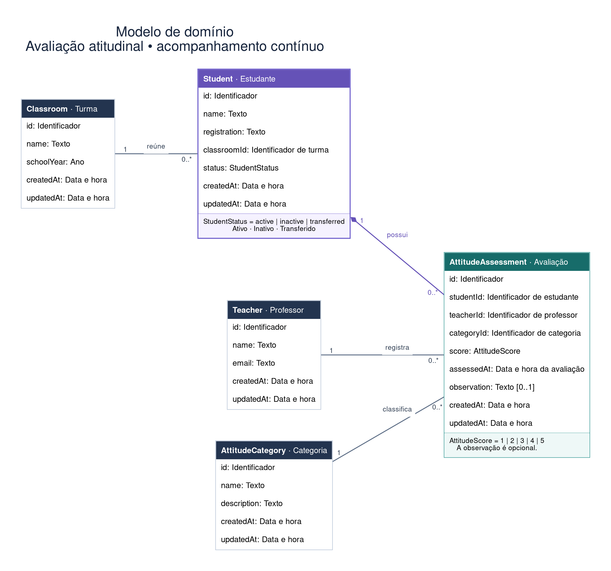
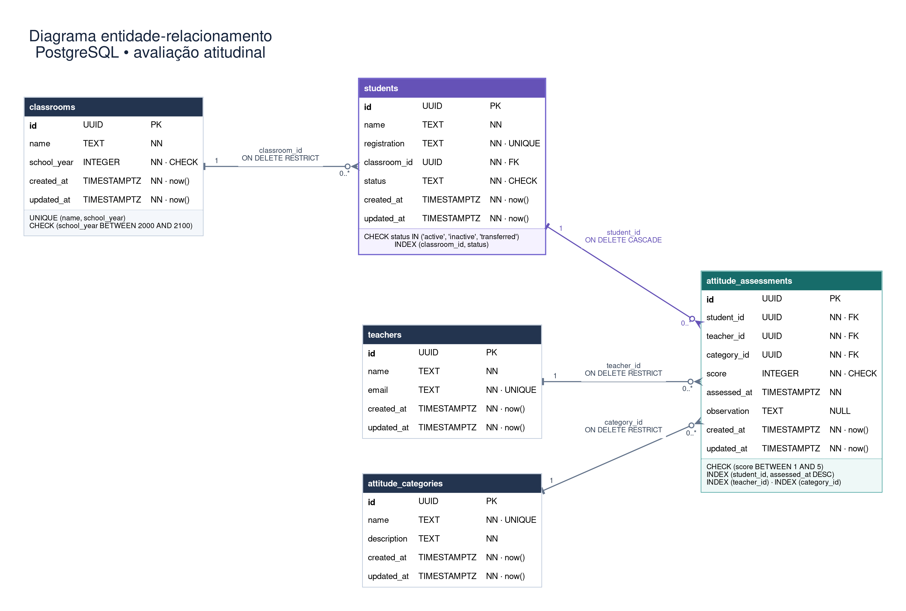

# Ânima · Avaliação Atitudinal

Sistema acadêmico para **acompanhar o desenvolvimento atitudinal de cada estudante**, a partir de avaliações formativas registradas por professores. Este marco reúne modelo de domínio, tradução relacional e uma interface Next.js alimentada por dados fictícios.

O recorte é o acompanhamento contínuo: cada avaliação relaciona um estudante, um professor, uma categoria, uma nota inteira de 1 a 5 e um instante. A média é um resumo do histórico, não um rótulo do estudante.

## Integrantes

- Allan Pinto Martins
- Felipe Pereira Madureira
- Gabriel Lima Castro Forte
- Samuel de Paula Paranhos

## Executar

Use **Node.js 24** (versão indicada em `.nvmrc`) e **npm 10 ou superior**. O requisito mínimo técnico declarado no projeto é Node.js 20.9. As dependências principais estão fixadas: Next.js 16.4.6, React 19.3.0 e TypeScript 5.9.3.

Na pasta do projeto:

```bash
npm install
npm run dev
```

Abra **[http://localhost:3000/lab/students](http://localhost:3000/lab/students)**. A página inicial `/` também encaminha para a listagem. Não são necessários banco, variáveis de ambiente ou contas externas. A primeira instalação requer acesso ao registro npm; depois dela, a demonstração usa apenas arquivos locais.

O `package-lock.json` permite instalação reprodutível com `npm ci`. Para executar a versão de produção:

```bash
npm run build
npm start
```

## O que explorar

| Endereço | Conteúdo |
| --- | --- |
| `/lab/students` | Cartões, busca por nome ou matrícula, filtros por turma e status, ordenação e exportação CSV. |
| `/lab/student?id=<UUID>` | Perfil de um estudante e histórico individual, consultados por ID. |
| `/lab/assessments` | Consulta das avaliações e das dimensões observadas. |
| `/lab/model` | Diagramas e apresentação do modelo utilizado. |

Há **18 estudantes, três turmas, três professores, cinco categorias e 80 avaliações**. Os três status aparecem na amostra; dois estudantes não têm avaliações. Todos os nomes, matrículas, vínculos e registros são fictícios. A escola exibida na interface também é fictícia.

Ao final da listagem, abra **Laboratório da interface**. Os botões **Carregar dados**, **Simular lista vazia** e **Simular erro** permitem verificar os estados exigidos sem editar o mock. Cada consulta aguarda 650 ms; **Tentar novamente** restaura o cenário de sucesso. O vazio da base e o vazio resultante de filtros têm mensagens diferentes.

## Os sete artefatos

### 1. UML: conceitos e relações

[`public/uml.png`](public/uml.png) apresenta `Student`, `Classroom`, `Teacher`, `AttitudeCategory` e `AttitudeAssessment`, com tipos conceituais e multiplicidades nas duas extremidades. A turma reúne zero ou mais estudantes; cada estudante possui uma turma. Avaliações podem ainda não existir, mas toda avaliação tem exatamente um estudante, um professor e uma categoria. A relação estudante-avaliação é composição.



### 2. DER: tradução para PostgreSQL

[`public/der.png`](public/der.png) traduz as cinco entidades para tabelas com `id UUID PRIMARY KEY`, `created_at TIMESTAMPTZ NOT NULL DEFAULT now()` e `updated_at`. Matrícula, e-mail e nome de categoria são únicos; turmas são únicas por nome e ano. Notas usam `INTEGER` com `CHECK`, status também usa `CHECK`, e os índices atendem aos vínculos e ao histórico por estudante.

Na composição, a FK utiliza `ON DELETE CASCADE`; as demais usam `RESTRICT`. O arquivo complementar [`database/schema.sql`](database/schema.sql) registra essas decisões e as triggers de atualização de timestamps, para a futura implementação. A interface deste marco não executa SQL.



Os PNGs têm fundo branco e largura superior a 1920 pixels. As fontes editáveis e os SVGs estão incluídos. Com **Graphviz** e **Python 3** instalados, regenere-os com `npm run diagrams`; essas ferramentas não são necessárias para iniciar a aplicação.

### 3. Tipos do domínio

[`src/types/domain.ts`](src/types/domain.ts) corresponde aos campos dos diagramas, sem `any` ou `enum`. As enumerações são uniões de literais; timestamps são strings ISO 8601 em UTC com sufixo `Z`. `ActionResult<T>` é a união discriminada `{ ok: true; data: T } | { ok: false; error: string; fieldErrors?: ... }`, preparada para futuras Server Actions.

`observation` é anulável porque uma avaliação pode não conter comentário. O campo sempre existe, com `string | null`. As médias não pertencem a `Student`: são calculadas a partir das avaliações. Campos `camelCase` no domínio correspondem a colunas `snake_case` no DER.

### 4. Dados mock

[`src/lib/data/students.ts`](src/lib/data/students.ts) exporta estudantes como array `readonly`, com os registros e o array congelados em runtime. Os dados usam UUIDs válidos, matrículas únicas e datas em UTC. As demais entidades têm arquivos próprios, preservando as referências entre registros e permitindo exibir casos com e sem avaliações.

### 5. Consultas mock

[`src/lib/data/index.ts`](src/lib/data/index.ts) oferece `listStudents(): Promise<Student[]>` e `getStudent(id): Promise<Student | null>`, além de consultas para as entidades relacionadas. Todas têm atraso de 650 ms e devolvem cópias isoladas dos registros. ID desconhecido resulta em `null`. As opções opcionais de cenário servem ao laboratório; chamadas sem opções usam o cenário normal.

A validação na fronteira de consulta detecta estudantes incompletos, status inválidos, datas inválidas, duplicidades e vínculos de turma inexistentes. Quando a fonte passar a ser um banco, esta camada poderá ser substituída mantendo o contrato de apresentação.

### 6. StudentCard

[`src/components/students/student-card.tsx`](src/components/students/student-card.tsx) começa com `"use client"`, recebe `StudentCardProps` e apresenta nome, matrícula e status legível. Usa `article`, `header`, `dl`, rótulos acessíveis e um link de perfil. Não realiza consultas, não usa hooks de estado/efeito e não cria handlers de clique. Turma e resumo de avaliações chegam por props opcionais.

### 7. StudentsPage

[`src/app/lab/students/page.tsx`](src/app/lab/students/page.tsx) consulta a camada mock em `useEffect`, protege retornos assíncronos com `cancelled` no cleanup e usa `key={student.id}`. Carregamento e vazio têm `role="status"`; erro usa `role="alert"`. Listas filtradas, contagens e médias são calculadas a partir dos dados e não duplicadas no estado React.

## Arquivos e responsabilidades

```text
TCD/
├── README.md                         # execução, escopo e decisões dos sete artefatos
├── package.json                      # dependências e comandos do projeto
├── package-lock.json                 # versões resolvidas para instalação reprodutível
├── tsconfig.json                     # TypeScript estrito e alias @/
├── next.config.ts                    # configuração do Next.js
├── next-env.d.ts                     # tipos de ambiente gerados pelo Next.js
├── .nvmrc                            # versão de Node recomendada
├── .gitignore                        # exclusão de dependências, builds e arquivos locais
├── public/
│   ├── uml.png                       # diagrama de classes exigido
│   ├── der.png                       # diagrama relacional exigido
│   ├── uml.svg                       # UML vetorial para ampliação
│   └── der.svg                       # DER vetorial para ampliação
├── docs/
│   ├── modelagem.md                  # cardinalidades, invariantes e limites do domínio
│   ├── verificacao.md                # matriz de critérios e roteiro de conferência
│   └── diagrams/
│       ├── uml.dot                   # fonte editável do UML
│       └── der.dot                   # fonte editável do DER
├── scripts/
│   ├── generate-diagrams.py          # exportação PNG/SVG e validação da largura
│   └── package-delivery.py           # ZIP de entrega sem dependências/builds
├── database/schema.sql               # contrato SQL para implementação futura
├── tests/
│   ├── run.ts                        # entrada das duas suítes de testes TypeScript
│   ├── domain.test.ts                # regras, integridade e consultas do domínio
│   ├── ui.test.ts                    # apresentação, semântica e estados em HTML
│   └── schema-smoke.sql              # 13 verificações opcionais em banco descartável
└── src/
    ├── types/domain.ts               # cinco entidades, uniões e ActionResult<T>
    ├── lib/
    │   ├── data/
    │   │   ├── students.ts           # estudantes fictícios imutáveis
    │   │   ├── classrooms.ts         # turmas fictícias
    │   │   ├── teachers.ts           # professores fictícios
    │   │   ├── categories.ts         # dimensões atitudinais
    │   │   ├── assessments.ts        # avaliações coerentes com as referências
    │   │   └── index.ts              # consultas assíncronas com latência e cenários
    │   └── domain/
    │       ├── students.ts           # filtros, ordenação, médias e formatação
    │       └── validation.ts         # type guards e integridade dos estudantes
    ├── components/
    │   ├── app-shell.tsx             # navegação e estrutura compartilhada
    │   ├── students/student-card.tsx # apresentação isolada de um estudante
    │   └── ui/
    │       ├── icon.tsx              # ícones vetoriais decorativos
    │       └── page-state.tsx        # mensagens de carregamento, erro e vazio
    └── app/
        ├── layout.tsx               # idioma, metadados e estrutura global
        ├── globals.css              # estilos, responsividade e foco visível
        ├── page.tsx                 # entrada que encaminha à listagem
        ├── not-found.tsx            # página para endereço inexistente
        └── lab/
            ├── students/page.tsx    # listagem e quatro estados da interface
            ├── student/page.tsx     # perfil e consulta de estudante por ID
            ├── assessments/page.tsx # acompanhamento das avaliações
            └── model/page.tsx       # consulta visual dos modelos
```

## Verificação

```bash
npx tsc --noEmit
npm run build
```

`npm run typecheck` é equivalente a `npx tsc --noEmit`. A tipagem e o build de produção foram aprovados. Consulte [`docs/verificacao.md`](docs/verificacao.md) para a matriz de aceite, o roteiro dos quatro estados e as evidências efetivamente verificadas.

A conferência interativa no navegador permanece pendente: este ambiente bloqueia a abertura do servidor local e a inicialização do Chromium. Os testes de apresentação verificam o HTML dos componentes, sem simular uma sessão de usuário. Execute o roteiro manual antes da entrega.

O Next.js foi configurado para verificar tipos pela API do compilador TypeScript (`experimental.useTypeScriptCli: false`), pois o subprocesso da CLI teve a captura de saída bloqueada neste ambiente. A checagem de tipos continua habilitada no build.